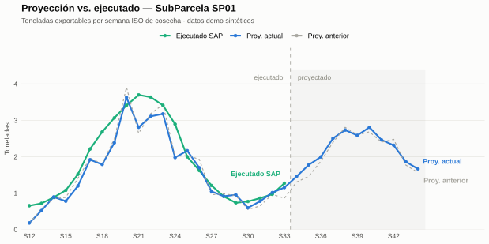
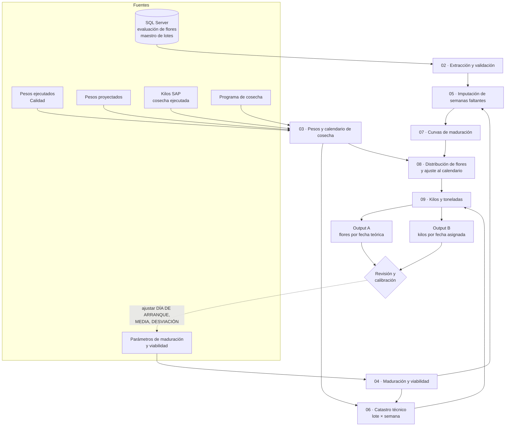

# Proyección semanal de kilos exportables de arándano a partir del conteo de flores

Pipeline en **R + SQL Server** que convierte el conteo semanal de flores nuevas en campo en una proyección de **kilos y toneladas exportables por lote y fecha de cosecha**, con un horizonte de ~9 semanas.

Reemplaza un armado manual en Excel que exigía copiar tablas dinámicas SubParcela por SubParcela y aplicar a mano las curvas de peso y la viabilidad.

> **Este repositorio corre sin base de datos.** Incluye un generador de datos sintéticos que reproduce la estructura exacta de los seis insumos reales, así que el pipeline completo se ejecuta con un solo comando. No contiene ningún dato productivo.

---

## Resultados en producción

| Métrica | Valor |
|---|---|
| Tiempo de elaboración semanal | de 12 h a 4 h (**−67 %**) |
| WAPE de toneladas, horizonte 1 semana, nivel total | **15 %** sobre 35 semanas de la campaña 2026-2027|
| Horizonte | ~9 semanas, derivado del programa de cosecha |
| Uso | Entregable oficial semanal para la gerencia de arándano y el área de Cosecha |

> El WAPE reportado es a nivel total. A nivel SubParcela es mayor, porque los
> errores de distinto signo dejan de compensarse; no está medido de forma sistemática todavía.



*Vista de revisión semanal: la curva de la semana actual contra la de la semana anterior y contra lo realmente cosechado. Es con lo que el proyectador decide si calibra. Salida del pipeline corrido sobre los datos demo sintéticos.*

---

## Ejecutar la demo

```bash
git clone https://github.com/<usuario>/flower-based-blueberry-yield-forecasting.git
cd flower-based-blueberry-yield-forecasting

Rscript install.R      # dependencias
Rscript main.R         # genera los insumos demo y corre el pipeline completo
```

La primera ejecución crea los insumos sintéticos en `data/demo/` y deja dos archivos en `output/`. Tarda unos segundos.

Para reproducir la figura del README hacen falta dos corridas, la de la semana anterior y la actual:

```bash
SEMANA_BASE=34 Rscript main.R      # proyección "anterior"
Rscript main.R                     # proyección "actual" (semana base del config)
Rscript R/graficar_proyeccion.R
```

`SEMANA_BASE` permite reproyectar cualquier semana pasada sin tocar la configuración — sirve para backtesting y para comparar corridas consecutivas. Con un solo exportable en `output/`, la figura sale con dos series en vez de tres.

Para correr las pruebas:

```bash
Rscript tests/test_funciones.R
```

> En Linux o macOS, R debe correr en un locale UTF-8 (`LANG=es_PE.UTF-8` o `C.UTF-8`). Los archivos del proyecto están en UTF-8 y, en un locale que no lo sea, `source()` trunca la lectura sin lanzar error. `main.R` verifica esto y se detiene con un mensaje claro.

---

## Arquitectura



El ciclo punteado es la parte del proceso que concentra el criterio del proyectador: se revisa la curva, se ajusta el parámetro y se vuelve a ejecutar **desde el módulo 04** (`ejecutar_desde(4)`), sin reconsultar SQL ni releer los pesos.

---

## Cómo se calcula

**1. Curva de maduración.** Las flores de una semana de evaluación no se cosechan todas el mismo día. Se reparten con una normal truncada sobre los días `1..PERIODO`, normalizada a 1:

```
Distribución(día) = Normal(día; MEDIA, DESVIACIÓN) ÷ Σ Normal(día)
```

**2. Fecha teórica de cosecha.** El `DÍA DE ARRANQUE` es el desfase entre la evaluación y el inicio de la ventana de maduración:

```
Flores promedio = Flores evaluadas ÷ Plantas evaluadas
Fecha teórica   = Fecha de evaluación + DÍA DE ARRANQUE + Día de curva − 1
```

**3. Ajuste al calendario real.** Cada aporte se asigna a la **primera fecha de cosecha del lote igual o posterior** a su fecha teórica. Las flores que maduran entre dos pasadas se acumulan en la siguiente pasada efectiva. El calendario combina fechas ejecutadas (derivadas de los registros SAP) y fechas programadas.

**4. Conversión a kilos.**

```
Prob_Exportable = 1 − No_Viabilidad
Kilos           = Flores acumuladas × Total_Plantas × (Peso ÷ 1000) × Prob_Exportable
Toneladas       = Kilos ÷ 1000
```

La separación es deliberada: **peso, plantas y viabilidad mueven la magnitud; calendario, arranque y parámetros de maduración mueven el momento y la concentración**. Eso permite diagnosticar por qué cambió una proyección antes de tocar un parámetro.

---

## Validaciones fail-fast

El pipeline se detiene ante datos inconsistentes en lugar de producir una proyección silenciosamente incorrecta:

| Qué valida | Dónde |
|---|---|
| Hojas y columnas requeridas en cada Excel | 01, 03, 04 |
| Claves incompletas y unicidad del grano en cada tabla | 02, 03, 04, 06 |
| Combinaciones Año-Semana que no son semanas ISO reales | 03, 04 |
| Peso de baya fuera del rango configurado (error de unidad) | 06 |
| Solape entre pesos ejecutados y proyectados | 03 |
| Lotes cuya programación empieza antes de terminar la cosecha ejecutada | 03 |
| Lotes programados que no existen en el maestro | 03 |
| Cobertura de peso y viabilidad para **todo** el horizonte | 06 |
| Curvas que no suman 1 o tienen valores fuera de `[0,1]` | 07 |
| Más de una fecha de evaluación por lote y semana ISO | 08 |
| Pérdida catastrófica de flores fuera del calendario de cosecha | 08 |
| Conservación de flores en la acumulación por fecha | 08 |
| Inflado de filas en el join final y kilos nulos | 09 |

La cobertura del horizonte (06) y la conservación de flores (08) son las dos que más errores reales atrapan: la primera porque una semana sin peso no existe en el catastro y sería invisible hasta aparecer como `Kilos NA` sin diagnóstico; la segunda porque cualquier join mal planteado aguas arriba se manifiesta como flores que aparecen o desaparecen.

---

## Estructura

```
.
├── main.R                      Orquestador: carga módulos y ejecuta
├── install.R                   Dependencias
├── config/
│   ├── config.example.yml      Configuración (copiar como config.yml)
│   └── .env.example            Credenciales SQL Server (solo modo sqlserver)
├── R/
│   ├── 00_utils.R              Funciones puras: helpers, lectores, validaciones
│   ├── 01_config.R             Periodo, rutas y horizonte efectivo
│   ├── 02_fuentes.R            Evaluación de flores y maestro (SQL o demo)
│   ├── 03_insumos.R            Pesos y calendario de cosecha
│   ├── 04_parametros.R         Maduración y viabilidad  ← punto de re-ejecución
│   ├── 05_imputacion.R         Semanas de evaluación faltantes
│   ├── 06_catastro.R           Maestro + pesos + viabilidad
│   ├── 07_curvas.R             Lista autorizada y curvas de maduración
│   ├── 08_distribucion.R       Distribución de flores y ajuste al calendario
│   ├── 09_kilos.R              Kilos, toneladas y exportación
│   ├── make_demo_data.R        Generador de insumos sintéticos
│   └── graficar_proyeccion.R   Figura del README
├── tests/
│   └── test_funciones.R        8 pruebas de las funciones de cálculo
└── docs/img/
```

---

## Configuración

Todo lo ajustable vive en `config/config.yml` — no hay rutas, IDs ni umbrales incrustados en el código:

| Clave | Para qué |
|---|---|
| `fuente` | `demo` (sintético) o `sqlserver` |
| `campania`, `subparcelas` | Alcance de la proyección (la demo trae 18 SubParcelas) |
| `anio_base`, `semana_base` | Semana base; la proyección arranca en la siguiente. `null` usa la fecha del sistema. La variable de entorno `SEMANA_BASE` la sobrescribe |
| `sql.*` | IDs de evaluación y cultivo, driver ODBC, cifrado |
| `sql.tablas.*` | Nombres de las tablas del esquema |
| `reglas.*` | Rango de peso, umbral de pasada de cosecha, tolerancias |
| `rutas.*`, `archivos.*` | Carpetas y plantillas de nombre por periodo |

El horizonte **no se configura**: se deriva de la última fecha del programa de cosecha para las SubParcelas configuradas. Si el programa se queda corto, la corrida se corta ahí y lo informa.

Los códigos de SubParcela de `config.example.yml` (`SP01`…`SP18`) son genéricos, igual que los nombres de tabla: los reales van en `config/config.yml`, que no se versiona.

Los nombres de tabla del esquema también son configuración. Los de `config.example.yml` son genéricos; en una instalación real se reemplazan en `config/config.yml`, que no se versiona. En las consultas se interpolan como identificadores citados (`{\`tabla\`}` de `glue_sql`), igual que los parámetros se interpolan como literales (`{valor}`): nada se concatena crudo.

---

## Decisiones de diseño

**Módulos secuenciales sobre entorno global, no funciones encadenadas.** El pipeline se lee de arriba hacia abajo y cada módulo deja sus tablas intermedias disponibles en la consola. Es deliberado: la calibración es iterativa y el proyectador necesita inspeccionar `flores_dist_por_semana` o `catastro` entre corridas. Envolver todo en funciones puras haría el código más ortodoxo y menos usable para el trabajo real que soporta.

**Dos excepciones, por testeabilidad.** `curva_maduracion_normalizada()` y `agrupar_pasadas_cosecha()` se usan una sola vez, pero son el cálculo central del modelo y la regla de negocio más sutil del pipeline. Están en `00_utils.R` con tests dedicados — incluido el caso sábado→lunes, donde el umbral de 2 días hace que dos cosechas separadas por un domingo cuenten como pasadas distintas.

**Fail-fast en lugar de imputar por defecto.** Un dato faltante que se rellena en silencio produce una proyección plausible y equivocada. La única imputación automática es la de semanas de evaluación faltantes, y queda registrada con su método (`INTERPOLACION_ANTERIOR_POSTERIOR`, `REFERENCIA_ANTERIOR`, `REFERENCIA_POSTERIOR`).

**Nombres internos en ASCII, exportables con tilde.** El procesamiento usa `Campania` y `Anio` para no depender del locale; al exportar se restauran los nombres originales para no romper los reportes Excel que consumen la salida.

---

## Supuestos y limitaciones

- El peso y la viabilidad se aplican a nivel **SubParcela-Semana**; el total de plantas, a nivel **Lote**.
- La viabilidad se define por semana **de cosecha**, no de evaluación.
- La hoja `Parametros` es la **lista autorizada**: toda evaluación fuera de ella se excluye antes de proyectar.
- Las flores cuya fecha teórica cae después de la última fecha del programa **no se asignan** en esa corrida; se recuperan cuando el programa incorpore nuevas fechas. En operación normal esto ronda el 15-25 %, porque las evaluaciones más recientes maduran más allá del horizonte.
- `Tramo = HISTORICO` se define por fecha respecto al inicio de la proyección. La semana base puede quedar marcada como histórica aunque use peso proyectado: **no es ejecutado puro**.
- Los insumos Excel se asumen en convención de semana **ISO**. No es verificable desde el archivo (no trae la fecha), así que solo se valida el rango y que la combinación Año-Semana exista.
- La aceptación final de la curva es **criterio experto**. No hay umbral estadístico automático ni número máximo de iteraciones de calibración.

---

## Datos

Los insumos de `data/demo/` son **sintéticos**, generados por `R/make_demo_data.R` con una semilla fija. Respetan la estructura, el grano y los rangos de validación de los archivos reales, y la forma estacional imita una campaña de arándano con dos picos de cosecha. Las **magnitudes no están calibradas a rendimientos reales**: sirven para demostrar el flujo, no para sacar conclusiones agronómicas.

La campaña demo está anclada a semanas ISO fijas, no a la semana base. Por eso dos corridas con semanas base distintas proyectan la *misma* campaña con distinto corte de información, que es lo que permite comparar "anterior" contra "actual" como en el reporte real.

No hay datos productivos en este repositorio, y `.gitignore` excluye `data/`, `output/`, `*.xlsx` y `.env` para que no entren por accidente.

---

## Stack

R 4.3+ · dplyr · tidyr · purrr · lubridate · readxl · writexl · yaml · DBI/odbc · testthat · ggplot2

## Licencia

MIT — ver [LICENSE](LICENSE).
